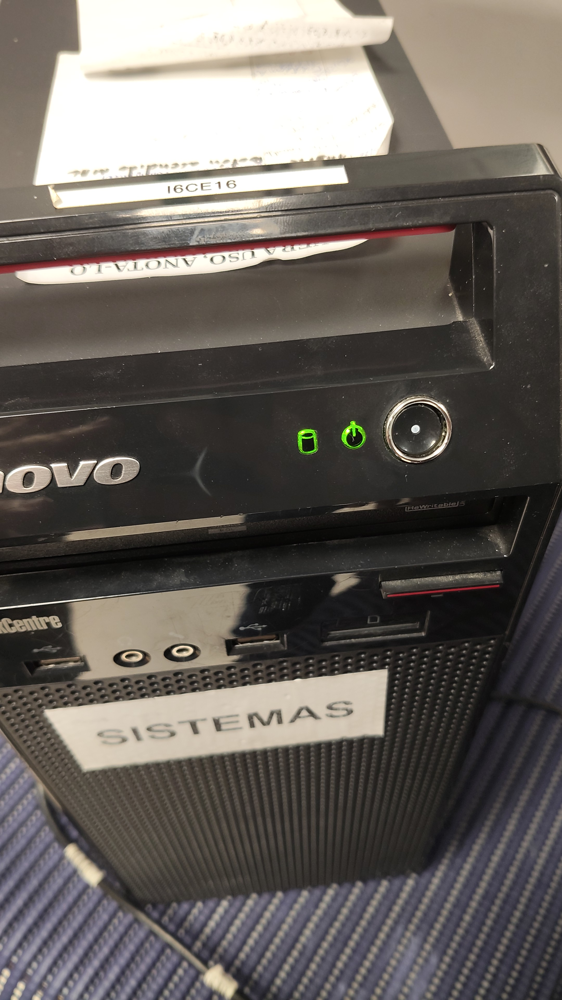
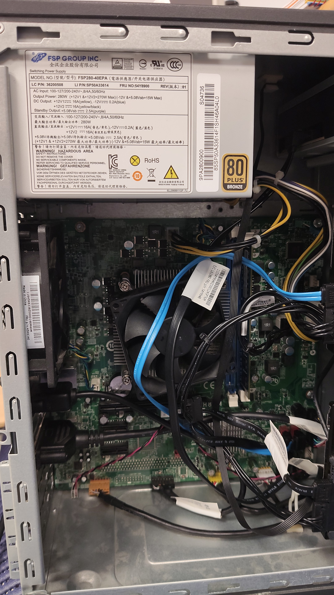
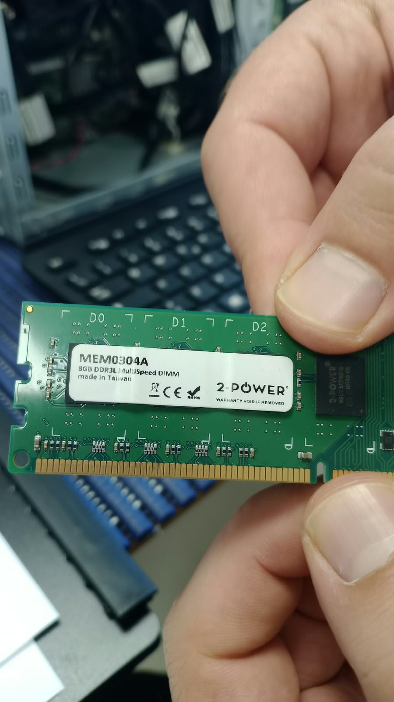
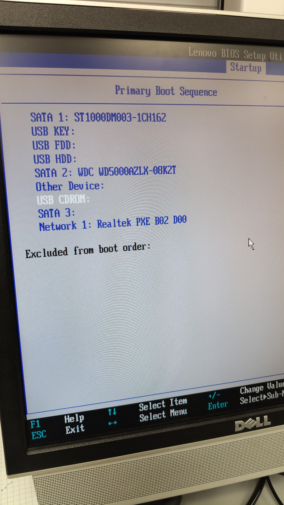
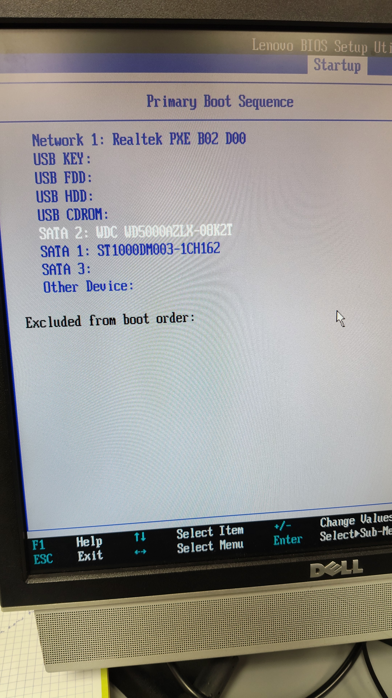
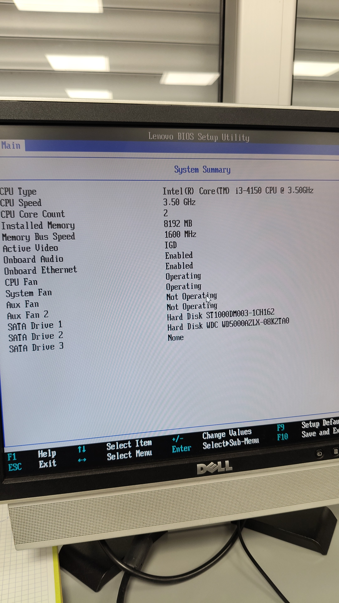

# Comprobación de alimentación

## Se comprueba que el ordenador enciende. Durante el encendido tambien nos percatamos de que la pantalla no recibe señal.

## Abrimos el teminal para asegurarnos de que esta todo completamente conectado y que el error no procede de una mala conexion.

## Con todo conectado seguimos sin señal en el monitor. Sospechamos que puede ser por la tarjeta de memoria. 
## La cambiamos de slot para comprobar si el error es de la memoria o del slot.

# Resultado do POST

## Hemos verificado que el error es de la tarjeta de memoria. Desconocemos el alcance pero podemos asegurar que al sustituir la tarjeta la pantalla recibe señal.

# Acceso á BIOS/UEFI para verificar que se detectan correctamente: modelo de microprocesador, número e tamaño dos módulos RAM, unidades de almacenamento

## 1. Secuencia de arranque original

# Procedemos a entrar en la BIOS
 ## Al arrancar la BIOS y realizar las comprobaciones nos percatamos que la secuencia de arranque no esta correctamente estructurada.

 ## Se procede a modificar la secuencia de arranque del ordenador poniendo el orden correcto para arrancar primero desde la red (Realtek PXE)

### 2. Modificación del orden de arranque

## Revisamos caracteristicas del sistema desde la BIOS. Entramos en MAIN:
## Como se observa en la siguiente imagen podemos confirmar las siguientes caracteristicas de nuestro equipo:
### características del equipo: Intel Core i3-4150 a 3,50 GHz, 8 GB de RAM a 1600 MHz y dos discos duros SATA.
### 3. Información del sistema

# Localización no manual dos códigos de erro sonoros, que poden advertir de erros durante o POST.

## Hemos localizado el manual de codigos de error de Lenovo:
## Manual de mantenimiento

[📘 Manual oficial Lenovo ThinkCentre Edge 72 (PDF)](https://download.lenovo.com/ibmdl/pub/pc/pccbbs/thinkcentre_pdf/edge72_hmm.pdf)

### Documentación técnica

Manual de mantenimiento del Lenovo ThinkCentre Edge 72.

Incluye información sobre:
- Componentes del equipo.
- Diagnóstico de averías.
- Códigos de pitidos de la BIOS.
- Errores durante el arranque (POST).
- Procedimientos de mantenimiento.

